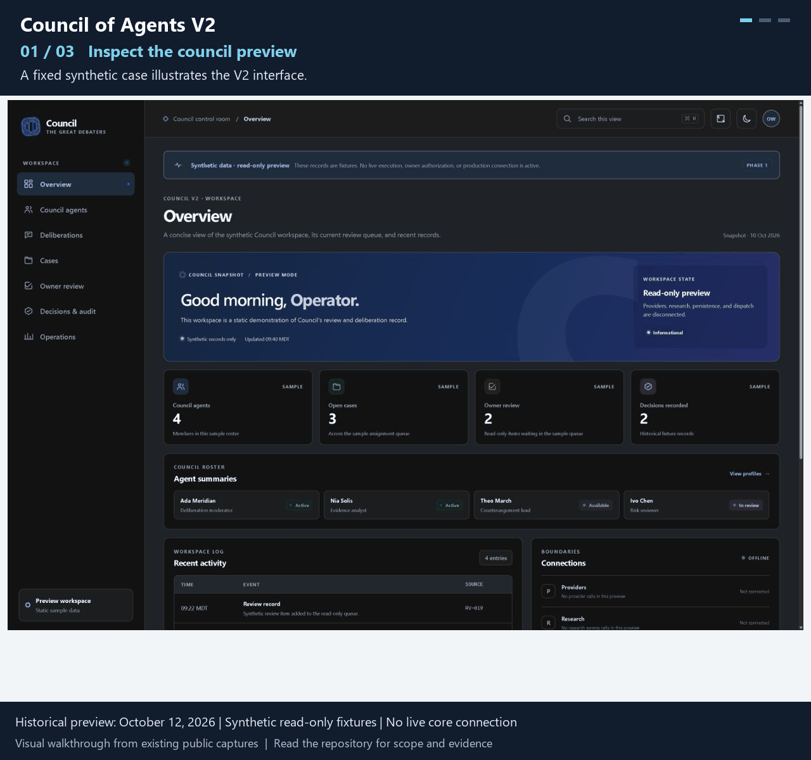

# Council of Agents V2

**Structured multi-agent deliberation with human-reviewed decisions.**

*15-second looping slideshow of the existing public images. Historical preview: October 12, 2026 | Synthetic read-only fixtures | No live core connection.*

Difficult questions benefit from distinct positions, peer challenge and an explicit record of disagreement. Council V2 structures that deliberation and returns material for a human decision. The V2 Rust core and its separate desktop preview must be distinguished from the older V1 presentation.

*Historical October 12 capture from the actual V2 preview; fixed synthetic fixtures, read-only, no live core connection.*

**Status:** Private V2 core; historical synthetic read-only preview; live integration not demonstrated.

[Walkthrough](docs/WALKTHROUGH.md) · [Technical explanation](docs/ARCHITECTURE.md) · [Validation scope](docs/EVIDENCE.md)

## From input to output

The actual V2 preview displays a synthetic regional-water-reuse case. Its deliberation record shows initial positions, cross-examination and revision, then an owner-review queue. The visible warning explains that stored decisions are historical records and the preview cannot authorize or dispatch work. These fixtures illustrate interface state, not a live multi-provider debate.

## My contribution

I defined the deliberation workflow, evidence and dissent requirements, owner-decision boundary and audit/recovery expectations. I directed AI-assisted implementation of the Rust core and later interface work, reviewed decisions and assessed agent-produced evidence. No V1 screenshots or test counts are used here.

## Architecture and decisions

The Rust core owns deliberation state, provider adapters, research provenance and durable audit/recovery logic. A React/Tauri Phase 1 preview reads fixed synthetic snapshots. The preview has no Council API adapter and no registered native Council command. Core capability, interface behavior and live provider readiness are separate claims.

- Make disagreement inspectable: independent positions and peer review can preserve dissent instead of presenting only a consensus summary. This costs additional review and may not resolve the question.
- Persist provenance and recovery state: durable records help explain interrupted work. They do not prove that the research or model answer is correct.
- Stop at human review: recommendations and stored OwnerDecision records do not authorize execution. The preview intentionally has no approve, authorize or dispatch control.

## Validation

The actual V2 core was identified at local main commit adb4d9b6f1032d26b7124ee141c84cbc2d21f090. The separate UI worktree uses b89c1be3cd4049ef827c0c8552b4d16d44238a88 plus recorded local changes. Retained October 12 screenshots have an accompanying file-hash candidate manifest and synthetic browser-check evidence. They are historical fixture-backed interface evidence, not fresh live deliberation or whole-system certification.

## Failure and human review

Provider or research failures, incomplete evidence and unresolved dissent must stay explicit. The core ends at owner review. Live certification and authorization require their own current boundaries; this task requested none and created none. The public preview images retain their synthetic/read-only banners.

## Limitations

No provider, paid API, consequential agent action or authentication change was used. The fixture preview does not read production SQLite or test live provider quality. Export and handoff behavior were not freshly exercised, so this showcase does not claim those behaviors are verified.

## Inspect or run

Inspect the fixture walkthrough, three captioned images and architecture explanation. The V2 implementation is private and is not available from this clean public case study. The old Council repository README is not used as V2 evidence.
