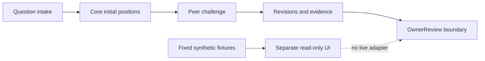

# Council of Agents V2: architecture

The Rust core owns deliberation state, provider adapters, research provenance and durable audit/recovery logic. A React/Tauri Phase 1 preview reads fixed synthetic snapshots. The preview has no Council API adapter and no registered native Council command. Core capability, interface behavior and live provider readiness are separate claims.

- Make disagreement inspectable: independent positions and peer review can preserve dissent instead of presenting only a consensus summary. This costs additional review and may not resolve the question.
- Persist provenance and recovery state: durable records help explain interrupted work. They do not prove that the research or model answer is correct.
- Stop at human review: recommendations and stored OwnerDecision records do not authorize execution. The preview intentionally has no approve, authorize or dispatch control.

This diagram is a conceptual architecture visual, not a runtime screenshot.

