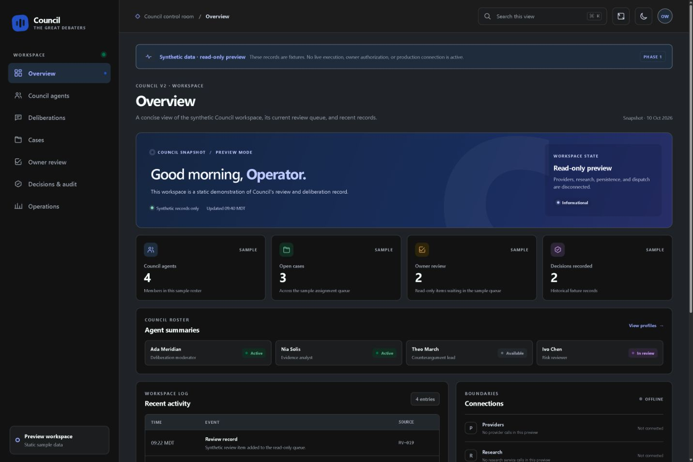
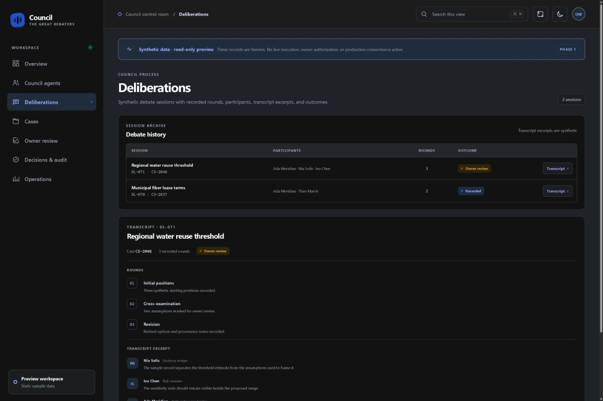
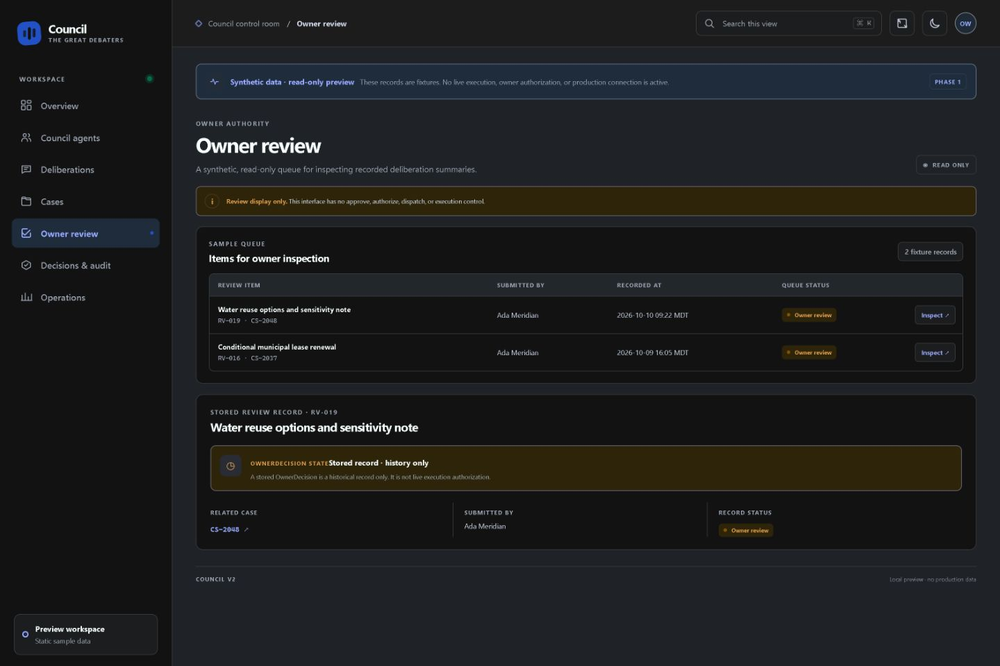

# Demonstrated scope

The actual V2 core was identified at local main commit adb4d9b6f1032d26b7124ee141c84cbc2d21f090. The separate UI worktree uses b89c1be3cd4049ef827c0c8552b4d16d44238a88 plus recorded local changes. Retained October 12 screenshots have an accompanying file-hash candidate manifest and synthetic browser-check evidence. They are historical fixture-backed interface evidence, not fresh live deliberation or whole-system certification.

No provider, paid API, consequential agent action or authentication change was used. The fixture preview does not read production SQLite or test live provider quality. Export and handoff behavior were not freshly exercised, so this showcase does not claim those behaviors are verified.

## Capture labels

Historical October 12 capture from the actual V2 preview; fixed synthetic fixtures, read-only, no live core connection.

*Historical October 12 capture from the actual V2 preview; fixed synthetic fixtures, read-only, no live core connection.*

*Historical October 12 capture from the actual V2 preview; fixed synthetic fixtures, read-only, no live core connection.*

*Historical October 12 capture from the actual V2 preview; fixed synthetic fixtures, read-only, no live core connection.*

The figures are evidence for the described inputs and version only. No badge, production adoption or business-impact claim is inferred.
